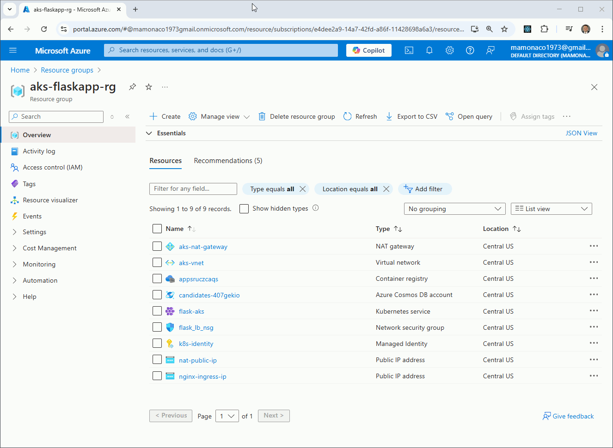
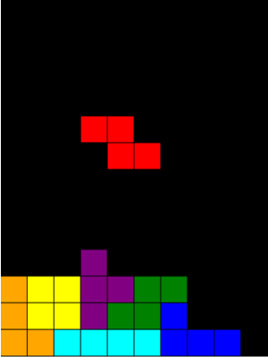
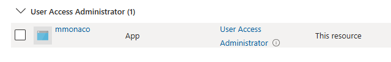

# Kubernetes on Azure: AKS with NGINX Ingress, ACR and Cosmos DB

Video 2 of the [Kubernetes in the Cloud](https://github.com/mamonaco1973/cloud-k8s-intro/blob/main/README.md)
series. The candidate microservice from
[Azure VM Scale Sets](https://github.com/mamonaco1973/azure-flask-vmss) and
[Simple Azure Containers](https://github.com/mamonaco1973/azure-flask-container)
runs here on **Azure Kubernetes Service**, next to three browser games
(Tetris, Frogger and Breakout). Images live in **Azure Container Registry**,
the Flask pods store candidates in **Cosmos DB** through workload identity,
and an **NGINX ingress controller** on one static public IP routes to
everything. Terraform builds the infrastructure and the ingress controller;
`kubectl` deploys the apps.



| Piece | Where | Role |
|---|---|---|
| **aks-vnet** | `10.0.0.0/8`, `aks-flaskapp-rg`, Central US | subnet `aks-subnet` (`10.240.0.0/16`) for nodes and pods (Azure CNI); NAT gateway for outbound traffic; an NSG allowing 80 and 8000 from anywhere |
| **flask-aks** | AKS | managed control plane, Standard load balancer, OIDC issuer and workload identity on; runs as the user-assigned identity `k8s-identity` |
| **default** pool | AKS | `Standard_D2s_v3`, 1 to 3 nodes with the cluster autoscaler; runs `flask-app` |
| **gamenodes** pool | AKS | `Standard_D2s_v3`, 1 node; runs the games in the `games` namespace |
| **nginx-ingress** | Helm, `ingress-nginx` | NGINX ingress controller on the static public IP `nginx-ingress-ip`; load balancer health probe on `/flask-app/api/gtg` |
| **flask-app** | Deployment | 2 replicas, scaled 2 to 5 by an HPA at 60% CPU; `/gtg` probes; service account `cosmosdb-access-sa` |
| **tetris**, **frogger**, **breakout** | Deployments, `games` | one replica each |
| **candidates-&lt;suffix&gt;** | Cosmos DB, serverless | `CandidateDatabase` / `Candidates`; a custom data role for `k8s-identity` |
| **apps&lt;suffix&gt;** | ACR, Basic | `flask-app` and `games` images, tagged `*-rc1` |

`k8s-identity` has Network Contributor (for the load balancer and IP),
AcrPull on the registry, and the Cosmos DB data role; a federated credential
lets `cosmosdb-access-sa` sign in as it.

## Architecture

<picture>
  <source media="(prefers-color-scheme: dark)" srcset="architecture-dark.svg">
  
</picture>

Regenerate with `python3 make_diagram.py`.

- **`01-acr/`**: the resource group, the registry, and the network (VNet,
  subnet, NSG, NAT gateway).
- **`02-docker/`**: the Flask app and the three games, each with its
  `Dockerfile`, plus the `test_candidates.py` smoke test.
- **`03-aks/`**: the identity and its roles, the cluster and both pools, the
  two service accounts, Cosmos DB, the ingress IP and Helm release, and the
  manifest templates in `yaml/`.
- **`stress.yaml`**: a CPU load generator for the autoscaling test.

## Endpoints

| Path | Returns |
|---|---|
| `GET /flask-app/api/gtg` | 200; with `?details=true`, connection details |
| `GET /flask-app/api/<name>` | the candidate, or 404 |
| `POST /flask-app/api/<name>` | `{"CandidateName": <name>}`, or 500 |
| `GET /flask-app/api/candidates` | every candidate, or 404 |
| `GET /games/tetris` | Tetris |
| `GET /games/frogger` | Frogger |
| `GET /games/breakout` | Breakout |

The games are [Tetris](https://gist.github.com/straker/3c98304f8a6a9174efd8292800891ea1),
[Frogger](https://gist.github.com/straker/82a4368849cbd441b05bd6a044f2b2d3)
and [Breakout](https://gist.github.com/straker/98a2aed6a7686d26c04810f08bfaf66b)
by Steven Lambert, served by NGINX.

| Tetris | Frogger | Breakout |
|---|---|---|
|  |  |  |

## Prerequisites

* [An Azure Account](https://portal.azure.com/)
* [Install AZ CLI](https://learn.microsoft.com/en-us/cli/azure/install-azure-cli)
* [Install Terraform](https://developer.hashicorp.com/terraform/install)
* [Install Docker](https://docs.docker.com/engine/install/) with `buildx`
* [Install kubectl](https://kubernetes.io/docs/tasks/tools/)
* The `Microsoft.App` resource provider registered on the subscription

`check_env.sh` expects a service principal in `ARM_CLIENT_ID`,
`ARM_CLIENT_SECRET`, `ARM_SUBSCRIPTION_ID` and `ARM_TENANT_ID`. It needs the
**User Access Administrator** role as well as Contributor, because Terraform
creates role assignments:



If this is your first time watching our content, we recommend starting with
this video: [Azure + Terraform: Easy Setup](https://www.youtube.com/watch?v=wwi3kVgYNOk).

## Deploy

```bash
git clone https://github.com/mamonaco1973/azure-k8s.git
cd azure-k8s
./apply.sh
```

`apply.sh`:

1. Applies **`01-acr`** (registry and network).
2. Logs Docker in to the registry and builds and pushes the Flask image and
   the three game images.
3. Applies **`03-aks`**: the identity, cluster, pools, Cosmos DB and the
   NGINX ingress.
4. Gets credentials for `kubectl`, renders `flask-app.yaml` and `games.yaml`
   with the registry name, and applies them.

It ends by running `validate.sh`, which waits for the ingress to get its IP
and for `/flask-app/api/gtg` to answer, then runs the smoke test:

```
NOTE: URL for AKS Deployment is http://<ingress IP>/flask-app/api/gtg?details=true
✓ good to go passed
✓ insert passed
✓ verification passed
✓ candidate list passed
```

## Try it

1. Open `http://<ingress IP>/games/tetris` (or `frogger`, `breakout`) in a
   browser, and call the Flask API with `curl` or Postman.
2. Check the workloads:

   ```bash
   kubectl get pods,deployments,ingress
   kubectl get pods,deployments,ingress -n games
   kubectl get nodes
   ```

3. Test autoscaling with the load generator in `stress.yaml`:

   ```bash
   kubectl apply -f stress.yaml
   # wait about 5 minutes
   kubectl get nodes          # the default pool grows, up to 3 nodes
   kubectl delete -f stress.yaml
   # wait about 5 minutes
   kubectl get nodes          # and shrinks back
   ```

## Teardown

```bash
./destroy.sh
```

## Is AKS PaaS or IaaS?

Both, in layers. Azure runs the Kubernetes control plane for you, and you
describe node pools instead of building VMs, which feels like PaaS.
Underneath, each pool is a VM Scale Set in a separate node resource group,
the autoscaler changes its size, and a `Service` of type `LoadBalancer`
becomes rules on an Azure load balancer and a public IP. AKS sits between
fully managed services such as Cosmos DB and plain VMs: control when you
want it, automation when you don't.

## Notes

- **Lab only.** The API and games are open to the internet over plain HTTP,
  and the NSG also opens port 8000 to everyone.
- `games.yaml` in the repository root is a rendered copy of the template
  with a real registry name (`appsg50eiuz9`) from an earlier deploy;
  `flask-app.yaml` is gitignored but `games.yaml` isn't.
- The registry has its admin user enabled, though the cluster pulls with
  AcrPull.
- `03-aks` also creates a `cluster-autoscaler` service account and federated
  credential in `kube-system`; AKS's built-in autoscaler doesn't use them.
